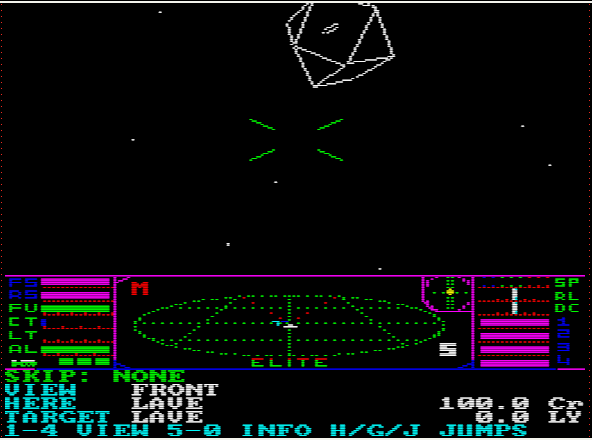
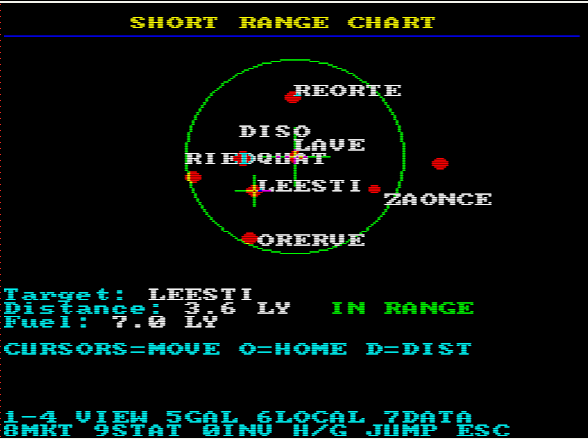

# QL_Elite

Port of **Elite (Apple II version, Firebird 1985)** to the **Sinclair QL** (68008, mode 8: 256 × 256 with 8 colours), written in C89 with
XTC68 (`qcc`) and a little assembler. It is a faithful port: it uses the original's 8-bit integer arithmetic, and every routine has been
compared, whenever possible, against the original 6502 code in an emulator (status in `INVENTARIO.md`).

The original game is by Ian Bell and David Braben. The reference code is Mark Moxon's (`elite-source-code-apple-ii`), which is used
only for consultation and verification; the port's code is original.

## How to run it on the QL (or in an emulator)

1. Build the disk image: `make elite.img` (720 KB DS/DD disk with `elite`, `boot`, `elite_scr` and `elite_dash`).
2. Mount `elite.img` as `flp1_` in the emulator (sQLux, QPC2, uQLx...) or copy it to a real disk, and start with
   `LRUN flp1_boot`. To install it on another drive or directory, copy the four files and change `dev$` in `boot`; the game looks for its data on `flp1_`, `flp2_`, `win1_`, `mdv1_`, `mdv2_` (and `DATA_USE`/`PROG_USE` with Toolkit II, or the drive passed with `EXEC_W dev$&"elite";dev$`).
3. Saved games are stored on the same drive as `elite_<name>` (disk menu, key `I` while docked).

Without the `elite_dash` file the game draws a minimal panel and warns with "NO ELITE_DASH FILE".

## How to build it

- Dependencies: `python3` (with `Pillow` for some tools), `gcc`, `make`, `git`, `meson` and `ninja`.
- QL compiler: `tools/install_xtc68.sh` installs XTC68 and the c68 runtime in `/tmp/qlsdk`. Then `make elite`
  produces the QDOS executable `elite`.
- PC version with the screen in memory: `make host_game`.
- Tests: `make test_all` (needs nothing else). The ones that compare against the original 6502 (`make test_orig`, `test_move`, `test_dash`,
  `test_arith`, `test_flight`...) need Moxon's source:
  `git clone https://github.com/markmoxon/elite-source-code-apple-ii /tmp/moxon` and
  `export ELITE_SRC=/tmp/moxon/1-source-files/main-sources`.
- The project documentation is in `CLAUDE.md` (full project memory) and `INVENTARIO.md` (status of the original's 528 routines),
  both in Spanish.

## Keys

### Title screen

| Key | Action |
|---|---|
| `1` | New commander (Jameson) |
| `2` | Load commander |
| `Q` | Quit |

### Screens (same in flight and docked)

| Key | Screen |
|---|---|
| `5` | Galactic chart |
| `6` | Short-range chart |
| `7` | System data |
| `8` | Market prices |
| `9` | Status |
| `0` | Inventory |

`ESC` returns from a screen to the status screen (docked) or to the space view (in flight).

### In flight

| Key | Action |
|---|---|
| Cursors | Roll (left/right) and pitch (up = dive, down = climb) |
| `F` / `D` | Speed up / slow down |
| `A` or space | Fire laser (hold down) |
| `1` `2` `3` `4` | Front, rear, left, right view |
| `T` / `M` / `U` | Arm missile / fire missile / unarm missile |
| `E` | ECM |
| `B` | Energy bomb |
| `J` | In-system jump |
| `H` | Hyperspace (requires a target system within range) |
| `G` | Galactic hyperdrive |
| `C` / `P` | Docking computer on / off (if fitted) |
| `ESC` | Escape pod (if fitted) |
| `=` | Pause (shows "PAUSED" on screen; `-` resumes) |

You can also dock by flying into the station's slot.

With the game **paused** (`=`): `D` damping, `A` keyboard auto-recentre, `X` credits and manual mis-jump (with `TAB`
during hyperspace), `F` flashing bars, `Y` joystick Y axis, `J` joystick axes, `K` joystick (CTL1, cursors and
space), `U` upper case only in mission texts, `T` tape/disk, `Q` / `S` sound off / on, `-` resume
playing and `ESC` back to the title.

### Docked

| Key | Action |
|---|---|
| `1` | Buy cargo |
| `2` | Sell cargo |
| `3` | Equipment (buy equipment and lasers) |
| `4` | Does nothing |
| `5`–`0` | Screens (see above) |
| `U` | Launch |
| `I` | Disk menu (save and load commander) |
| `H` / `G` | Show "DOCKED" (you cannot jump while docked) |

### Market and equipment

Cursor up/down to choose an item, digits for the quantity, `M` for the maximum, `ENTER` to confirm and `ESC` to leave.

### Charts

The cursors move the crosshairs; `F` finds a system by name (docked only); `D` selects the system nearest to the crosshairs; `O`
returns to the current system.

### QL keyboard

The cursors and space act as the CTL1 joystick. In an emulator, `Shift + ESC` is the emergency exit. The keyboard is read
row by row (`KEYROW`), so three keys pressed forming a rectangle in the matrix can produce a ghost key.

## Game data (`data/`)

- `elite_dash`: instrument panel background (256 × 56 in mode 8). It can be edited on the PC: `make dash_png` exports it to
  `data/cabina.png`, you edit it with the QL's 8 colours, and `make dash_from_png` regenerates it. More details in `data/README.txt`.
- `boot`: SuperBASIC boot program. `elite_scr`: loading screen.

## Credits

Elite: Ian Bell and David Braben. Reference documented code: Mark Moxon. QL port: A. Alea and Claude, 2026.
